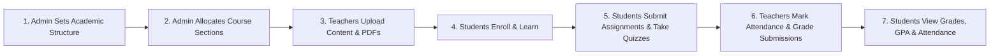

# 🎓 College Learning Management System (LMS)

A modern, full-stack, enterprise-grade Web-based Learning Management System designed for colleges and universities. It centralizes all academic workflows across **Admins**, **Teachers**, and **Students** with full multi-department and multi-semester support.

---

## 🏛️ System Architecture & Tech Stack

| Layer | Technology | Description |
| :--- | :--- | :--- |
| **Frontend** | **React 19 + TypeScript + Vite** | Blazing-fast SPA, fully responsive modern UI with strict type-safety. |
| **Styling** | **Tailwind CSS + Lucide Icons** | Polished dark mode theme with glassmorphism effects and clean typography. |
| **Backend** | **FastAPI (Python 3.11)** | High-performance async RESTful API with automated Swagger/OpenAPI documentation. |
| **Database ORM** | **SQLModel / SQLAlchemy** | Type-safe database operations with support for migrations and relational integrity. |
| **Database** | **SQLite (Dev) / PostgreSQL (Prod)** | Zero-configuration local database (`lms.db`) with production PostgreSQL readiness. |
| **Authentication** | **OAuth2 with JWT & PBKDF2** | Secure token-based auth with salted password hashing and role-based access control. |

---

## 🚀 Complete Setup Guide (From Clone to Live App)

Follow these step-by-step instructions to run the LMS on any new computer (Windows, macOS, or Linux).

### Prerequisites
Before you start, make sure you have installed:
- **Python 3.10+** (Recommended: Python 3.11): [python.org](https://www.python.org/)
- **Node.js 18+** (Recommended: Node.js 20 or 22): [nodejs.org](https://nodejs.org/)
- **Git**: [git-scm.com](https://git-scm.com/)

---

### Step 1: Clone the Repository
Open your terminal and clone the repository:
```bash
git clone https://github.com/<your-username>/lms.git
cd lms
```

---

### Step 2: Backend Setup (Virtual Environment & Dependencies)

1. Navigate to the `backend` folder:
   ```bash
   cd backend
   ```

2. Create a virtual environment:
   ```bash
   python -m venv venv
   ```

3. Activate the virtual environment:
   - **Windows (PowerShell)**:
     ```powershell
     .\venv\Scripts\Activate.ps1
     ```
     *(If you see an execution policy error, run: `Set-ExecutionPolicy -Scope Process -ExecutionPolicy Bypass` and try again).*
   - **Windows (Command Prompt)**:
     ```cmd
     .\venv\Scripts\activate.bat
     ```
   - **macOS / Linux**:
     ```bash
     source venv/bin/activate
     ```

4. Install backend dependencies:
   ```bash
   pip install -r requirements.txt
   ```

---

### Step 3: Populate Full University Dummy Data (1-Click Seed)

To instantly populate the database with a **complete university scenario** (2 Departments, 2 Programs, Semesters, 5 Courses, Teachers, Students, Section Allocations, PDF Materials, Lessons, Assignments, Submissions, Grades, Attendance, and Auto-graded Quizzes), run:

```bash
# If you are inside the backend directory:
python seed.py

# Or from the project root (lms/):
python seed.py
```

> **What happens during seeding?**  
> In ~2 seconds, it creates all tables, registers 10 users, allocates courses across Computer Science & Electrical Engineering departments, uploads mock lecture slides, grades student submissions with real teacher feedback, and generates attendance & quiz attempts.

---

### Step 4: Frontend Setup (Install Node Modules)

1. Open a new terminal window and navigate to the `frontend` directory:
   ```bash
   cd frontend
   ```

2. Install npm dependencies:
   ```bash
   npm install
   ```

---

### Step 5: Start the Local Development Servers

You will run the backend and frontend in two separate terminal windows.

#### 🖥️ Terminal 1: Start Backend API Server
```bash
cd backend
# Make sure virtual environment is active:
# Windows: .\venv\Scripts\activate
# Mac/Linux: source venv/bin/activate

python -m uvicorn main:app --host 127.0.0.1 --port 8000 --reload
```
- 🌐 **Backend API Root**: [http://127.0.0.1:8000](http://127.0.0.1:8000)
- 📖 **Interactive Swagger Docs**: [http://127.0.0.1:8000/docs](http://127.0.0.1:8000/docs) *(Best for professor inspection during Viva)*

#### 💻 Terminal 2: Start Frontend Web Application
```bash
cd frontend
npm run dev
```
- 🚀 **Frontend Web Application**: [http://127.0.0.1:5173](http://127.0.0.1:5173)

---

## 🔑 Pre-Configured Test Accounts

The seed script pre-configures accounts for every academic role:

| Role | Name | Department | Email | Password |
| :--- | :--- | :--- | :--- | :--- |
| **Admin** | System Administrator | Management | `admin@lms.com` | `admin123` |
| **Teacher** | Dr. Sarah Jenkins | Computer Science | `teacher@lms.com` | `teacher123` |
| **Teacher** | Prof. Tariq Mahmood | Computer Science | `prof.tariq@lms.com` | `password123` |
| **Teacher** | Dr. Ayesha Malik | Electrical Engineering | `dr.ayesha@lms.com` | `password123` |
| **Teacher** | Dr. Bilal Khan | Computer Science | `dr.bilal@lms.com` | `password123` |
| **Student** | John Doe | Computer Science | `student@lms.com` | `student123` |
| **Student** | Ali Ahmed | Computer Science | `ali.ahmed@lms.com` | `password123` |
| **Student** | Sara Khan | Computer Science | `sara.khan@lms.com` | `password123` |
| **Student** | Usman Raza | Electrical Engineering | `usman.raza@lms.com` | `password123` |
| **Student** | Fatima Noor | Electrical Engineering | `fatima.noor@lms.com` | `password123` |

---

## 🎯 Verified Academic Lifecycle

The LMS covers the complete lifecycle of a modern higher-education institution:



1. **Admin Governance**:
   - Manage Departments (e.g. CS, EE) and Degree Programs (BSCS, BSEE).
   - Manage Semesters (Active / Past) and Student Batches.
   - Approve & Publish courses.
   - Allocate course sections to designated teachers.
   - Audit logs for all administrative actions.

2. **Teacher Workspace**:
   - View assigned sections and enrolled student rosters.
   - Upload course materials (PDFs, slides, lab manuals) with direct download links.
   - Create and organize structured text lessons.
   - Post assignments with deadlines and max points.
   - Review student submissions and assign numeric grades with written feedback.
   - Mark daily student attendance with instant present/absent stats.
   - Create MCQs and True/False quizzes.

3. **Student Portal**:
   - Browse catalog and enroll in available course sections.
   - Access course syllabus, lessons, and downloadable PDF materials.
   - Submit assignment files and textual solutions.
   - Attempt timed online quizzes with instant auto-grading.
   - View attendance percentage with 75% minimum university threshold warnings.
   - Check verified gradebook and teacher feedback.

---

## 📚 Project Documentation & Viva Preparation Kit

All comprehensive academic reports, presentations, and guides are located in the [`docs/`](docs/) directory:

- 📄 **English Project Report & 15-Slide Presentation Kit**: [`docs/PROJECT_DOCUMENTATION_AND_PPT_GUIDE.md`](docs/PROJECT_DOCUMENTATION_AND_PPT_GUIDE.md)  
  *(Includes Executive Summary, System Architecture, Database ERD, Security Architecture, Testing Audit, and complete 15-slide presentation notes with anticipated Viva questions).*
- 📖 **Roman Urdu Detailed Project Guide**: [`docs/PROJECT_GUIDE_ROMAN_URDU.md`](docs/PROJECT_GUIDE_ROMAN_URDU.md)  
  *(Simple Roman Urdu explanations of how the project works, viva defense preparation, and common questions).*
- 🖼️ **High-Resolution UI Screenshots**: [`docs/screenshots/`](docs/screenshots/)  
  *(Over 45 HD full-page screenshots capturing every public, student, teacher, admin page, and end-to-end multi-department workflows).*

---

## 🛠️ Common Troubleshooting

- **PowerShell Script Execution Error**:
  ```powershell
  Set-ExecutionPolicy -Scope Process -ExecutionPolicy Bypass
  ```
- **Port 8000 or 5173 already in use**:
  - For backend: run on another port: `uvicorn main:app --port 8001 --reload`
  - For frontend: Vite will automatically suggest port `5174` if `5173` is busy.
- **SQLite Database Locking**:
  - SQLite handles concurrent reads easily. If writing from multiple processes, ensure previous uvicorn instances are closed.
- **Resetting Database Cleanly**:
  - Simply delete `backend/lms.db` and run `python seed.py` to regenerate the full university database from scratch.
