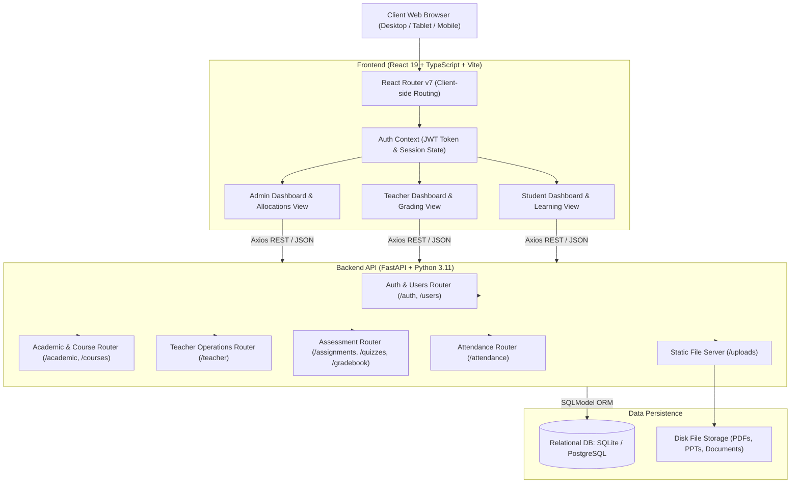
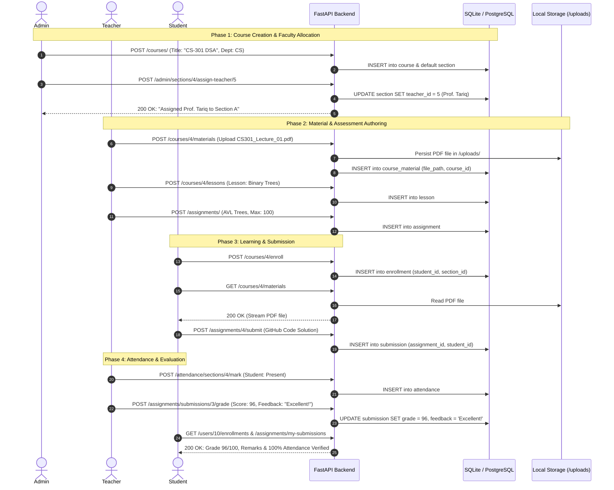
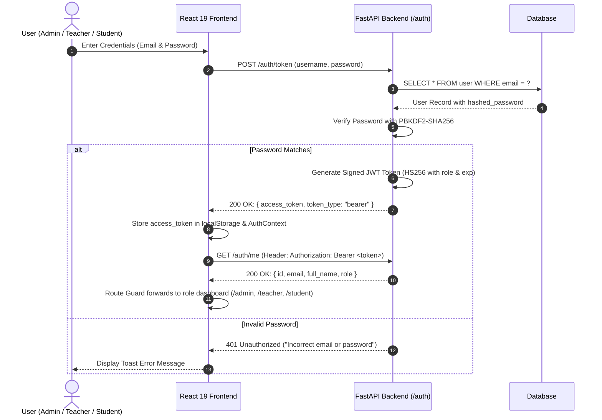
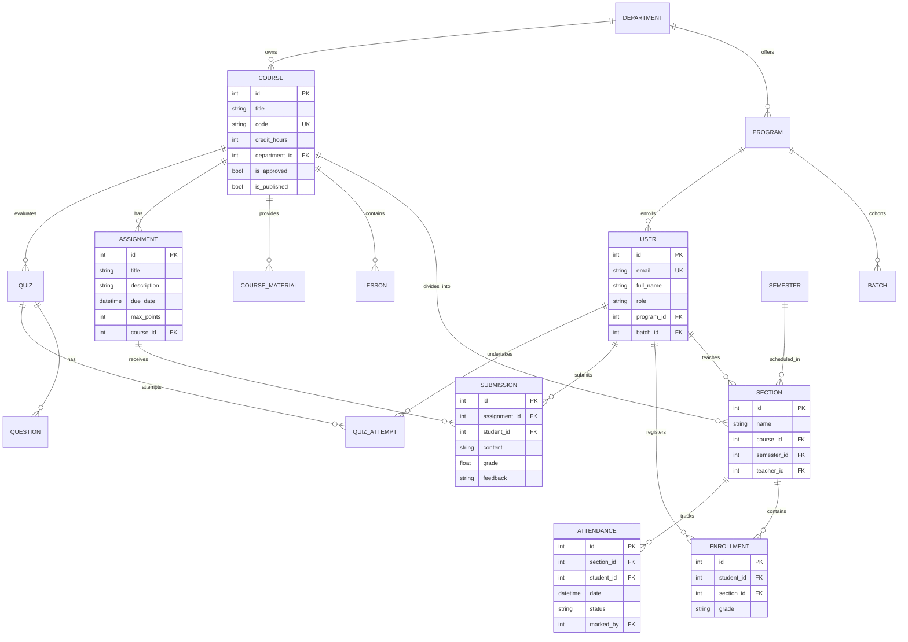

# Centralized College Learning Management System (LMS)
## Complete Project Documentation & Presentation Kit

---

## 1. Executive Summary & Project Overview

### 1.1 Project Title
**Centralized Web-Based College Learning Management System (College LMS 2.0)**

### 1.2 Abstract
Traditional academic workflows in colleges and universities often suffer from fragmented communication, manual attendance registers, disjointed assignment submissions, and a lack of real-time grading transparency. 

The **College Learning Management System (LMS)** is a modern, responsive, full-stack web application engineered to centralize and automate core academic operations. The system features a strict **Role-Based Access Control (RBAC)** architecture supporting three distinct user profiles: **Administrators**, **Teachers (Faculty)**, and **Students**. Built using a high-performance **FastAPI (Python)** backend and an interactive **React 19 + TypeScript + Vite** frontend, the system supports course allocations, lesson authoring, lecture material distribution, timed quiz assessments, assignment grading, attendance monitoring, and discussion boards.

---

## 2. Problem Statement & Objectives

### 2.1 Problem Statement
- **Manual Overhead:** Paper-based attendance recording and physical submission handling cause substantial administrative overhead and record loss.
- **Allocation Ambiguity:** Department heads struggle to dynamically assign teachers to sections and track student cohorts across semesters.
- **Lack of Transparency:** Students frequently experience delays in receiving graded submissions, GPA calculations, and attendance threshold warnings.

### 2.2 Project Objectives
1. **Unified Academic Hierarchy:** Implement an academic structure connecting Departments, Programs, Batches, Semesters, Courses, and Sections.
2. **Automated Teacher Allocation:** Enable administrators to assign faculty to course sections with instant reflection across dashboards.
3. **Rich Content & Assessment Delivery:** Allow teachers to upload files (PDFs/slides), author interactive modules, conduct timed quizzes, and provide granular feedback on student submissions.
4. **Transparent Student Portal:** Provide students with a real-time portal for course progress, attendance health, assignment submission, and GPA tracking.
5. **Robust Security & High Performance:** Guarantee secure authentication via OAuth2/JWT tokens and responsive single-page application (SPA) performance.

---

## 3. Technology Stack & Architectural Rationale

| Layer | Technology | Version | Rationale & Justification |
| :--- | :--- | :--- | :--- |
| **Frontend Framework** | **React** | `19.2.0` | Component-based, virtual DOM efficiency, modular state management. |
| **Language (UI)** | **TypeScript** | `5.9.3` | Type safety, compile-time error detection, scalable enterprise code. |
| **Build Tool** | **Vite** | `7.3.0` | Instant Hot Module Replacement (HMR) and optimized rollup production bundles. |
| **Styling & Icons** | **Tailwind CSS & Lucide** | `v4` | Utility-first CSS, modern dark glassmorphism aesthetic, lightweight SVG icons. |
| **Backend Framework**| **FastAPI** | `0.143.0` | Asynchronous high-speed Python web framework, automatic OpenAPI (Swagger) documentation, dependency injection. |
| **ORM / Data Layer** | **SQLModel / SQLAlchemy** | `0.0.48 / 2.1.4` | Combines Pydantic data validation with SQLAlchemy ORM power. |
| **Database** | **SQLite (Dev) / PostgreSQL (Prod)** | - | Frictionless local development with SQLite (`lms.db`); migration-ready for PostgreSQL in production. |
| **Authentication** | **OAuth2 & JWT** | `HS256` | Stateless bearer token authentication with PBKDF2-SHA256 password hashing. |

---

## 4. System Architecture & High-Level Design

### 4.1 Architecture Diagram


### 4.2 Process Sequence Diagrams

#### A. University Academic Lifecycle Sequence Diagram


#### B. Authentication & JWT Handshake Sequence Diagram


---

## 5. Entity Relationship Diagram (ERD) & Database Schema

### 5.1 Academic Hierarchy Flow
$$\text{Department} \longrightarrow \text{Program} \longrightarrow \text{Batch} \longrightarrow \text{Semester} \longrightarrow \text{Course} \longrightarrow \text{Section} \longrightarrow \text{Enrollment}$$

### 5.2 Mermaid ERD


### 5.3 Comprehensive Database Data Dictionary

| Table Name | Column Name | Data Type | Constraints | Description |
| :--- | :--- | :--- | :--- | :--- |
| **`department`** | `id` | `INTEGER` | `PRIMARY KEY`, Auto | Unique department identifier. |
| | `name` | `VARCHAR` | `UNIQUE`, `INDEX`, Not Null | Full department title (e.g., Computer Science). |
| | `code` | `VARCHAR` | `UNIQUE`, `INDEX`, Not Null | Department short code (e.g., CS, EE). |
| **`program`** | `id` | `INTEGER` | `PRIMARY KEY`, Auto | Unique academic degree program ID. |
| | `name` | `VARCHAR` | Not Null | Degree title (e.g., BS Computer Science). |
| | `code` | `VARCHAR` | Not Null | Program acronym (e.g., BSCS, BSEE). |
| | `department_id` | `INTEGER` | `FOREIGN KEY` -> `department.id` | Associated parent department. |
| **`batch`** | `id` | `INTEGER` | `PRIMARY KEY`, Auto | Cohort batch identifier. |
| | `name` | `VARCHAR` | Not Null | Cohort label (e.g., Batch 2026-CS). |
| | `program_id` | `INTEGER` | `FOREIGN KEY` -> `program.id` | Program under which batch studies. |
| | `start_date` | `DATETIME` | Not Null | Official start of the batch cohort. |
| | `is_active` | `BOOLEAN` | Default `True` | Whether cohort is currently active. |
| **`semester`** | `id` | `INTEGER` | `PRIMARY KEY`, Auto | Academic semester identifier. |
| | `name` | `VARCHAR` | Not Null | Semester label (e.g., Fall 2026). |
| | `is_active` | `BOOLEAN` | Default `False` | Currently active teaching semester flag. |
| **`course`** | `id` | `INTEGER` | `PRIMARY KEY`, Auto | Course offering identifier. |
| | `title` | `VARCHAR` | Not Null | Course subject title (e.g., Database Systems). |
| | `code` | `VARCHAR` | `UNIQUE`, Not Null | Catalog course code (e.g., CS-202). |
| | `credit_hours` | `INTEGER` | Default `3` | Academic credit value. |
| | `department_id` | `INTEGER` | `FOREIGN KEY` -> `department.id` | Department administering the course. |
| | `is_approved` | `BOOLEAN` | Default `False` | Administrative curricular approval flag. |
| | `is_published` | `BOOLEAN` | Default `False` | Visibility status in student catalog. |
| **`section`** | `id` | `INTEGER` | `PRIMARY KEY`, Auto | Class section identifier. |
| | `name` | `VARCHAR` | Not Null | Section designation (e.g., Section A). |
| | `course_id` | `INTEGER` | `FOREIGN KEY` -> `course.id` | Course being taught in section. |
| | `semester_id` | `INTEGER` | `FOREIGN KEY` -> `semester.id` | Semester timeframe of the class. |
| | `teacher_id` | `INTEGER` | `FOREIGN KEY` -> `user.id` (Nullable)| Allocated faculty instructor. |
| | `schedule` | `VARCHAR` | Nullable | Class meeting times (e.g., Mon/Wed 10:00). |
| **`user`** | `id` | `INTEGER` | `PRIMARY KEY`, Auto | User account ID. |
| | `email` | `VARCHAR` | `UNIQUE`, `INDEX`, Not Null | Official university email / login handle. |
| | `full_name` | `VARCHAR` | Not Null | Display name of the user. |
| | `role` | `VARCHAR` | Enum (`admin`, `teacher`, `student`) | Access privilege role. |
| | `hashed_password`| `VARCHAR` | Not Null | Salted PBKDF2-SHA256 password hash. |
| | `program_id` | `INTEGER` | `FOREIGN KEY` -> `program.id` | Enrolled degree program (Students). |
| | `batch_id` | `INTEGER` | `FOREIGN KEY` -> `batch.id` | Cohort batch (Students). |
| | `is_active` | `BOOLEAN` | Default `True` | Account operational status. |
| **`enrollment`** | `id` | `INTEGER` | `PRIMARY KEY`, Auto | Student enrollment record. |
| | `student_id` | `INTEGER` | `FOREIGN KEY` -> `user.id` | Registered student. |
| | `section_id` | `INTEGER` | `FOREIGN KEY` -> `section.id` | Enrolled course section. |
| | `grade` | `VARCHAR` | Nullable | Final calculated letter grade (A, B+, etc.). |
| **`course_material`**| `id`| `INTEGER`| `PRIMARY KEY`, Auto | Uploaded document ID. |
| | `title` | `VARCHAR` | Not Null | Display title (e.g., Lecture 01 Slides). |
| | `file_path` | `VARCHAR` | Not Null | Relative path in `/uploads/` file directory. |
| | `course_id` | `INTEGER` | `FOREIGN KEY` -> `course.id` | Course resource belongs to. |
| **`assignment`** | `id` | `INTEGER` | `PRIMARY KEY`, Auto | Course assignment record. |
| | `title` | `VARCHAR` | Not Null | Assignment title. |
| | `description` | `TEXT` | Nullable | Problem instructions and guidelines. |
| | `due_date` | `DATETIME` | Not Null | Submission deadline (UTC timezone). |
| | `max_points` | `INTEGER` | Default `100` | Maximum points scale. |
| | `course_id` | `INTEGER` | `FOREIGN KEY` -> `course.id` | Associated course. |
| **`submission`** | `id` | `INTEGER` | `PRIMARY KEY`, Auto | Student assignment submission. |
| | `assignment_id`| `INTEGER` | `FOREIGN KEY` -> `assignment.id` | Assignment being submitted to. |
| | `student_id` | `INTEGER` | `FOREIGN KEY` -> `user.id` | Submitting student. |
| | `content` | `TEXT` | Not Null | Submitted text, solution, or repo link. |
| | `file_path` | `VARCHAR` | Nullable | Uploaded homework file path. |
| | `grade` | `FLOAT` | Nullable | Score awarded by evaluating faculty. |
| | `feedback` | `TEXT` | Nullable | Detailed constructive teacher remarks. |
| **`attendance`** | `id` | `INTEGER` | `PRIMARY KEY`, Auto | Daily attendance entry. |
| | `section_id` | `INTEGER` | `FOREIGN KEY` -> `section.id` | Section session attended. |
| | `student_id` | `INTEGER` | `FOREIGN KEY` -> `user.id` | Student marked. |
| | `date` | `DATETIME` | Not Null | Session date. |
| | `status` | `VARCHAR` | Enum (`present`, `absent`, `late`) | Attendance state. |
| | `marked_by` | `INTEGER` | `FOREIGN KEY` -> `user.id` | Teacher who registered the mark. |
| **`quiz`** | `id` | `INTEGER` | `PRIMARY KEY`, Auto | Online assessment quiz. |
| | `title` | `VARCHAR` | Not Null | Quiz assessment title. |
| | `time_limit` | `INTEGER` | Not Null | Duration limit in minutes. |
| | `passing_score`| `INTEGER` | Default `60` | Passing percentage threshold. |
| | `course_id` | `INTEGER` | `FOREIGN KEY` -> `course.id` | Course quiz evaluates. |
| **`quiz_attempt`**| `id` | `INTEGER` | `PRIMARY KEY`, Auto | Student test attempt. |
| | `quiz_id` | `INTEGER` | `FOREIGN KEY` -> `quiz.id` | Quiz attempted. |
| | `student_id` | `INTEGER` | `FOREIGN KEY` -> `user.id` | Examinee student. |
| | `score` | `FLOAT` | Nullable | Auto-graded point total. |
| | `max_score` | `FLOAT` | Nullable | Maximum possible points. |
| | `percentage` | `FLOAT` | Nullable | Final calculated test percentage. |

---

## 6. Functional Modules Specification

### 6.1 Administrator Module
- **System Metrics:** Real-time metrics of active users, programs, departments, and course numbers.
- **Academic Structure Management:** Full CRUD on Departments (e.g., Computer Science), Programs (e.g., BSCS), Batches (e.g., 2026), and Semesters.
- **Course Approvals:** Admin verifies courses proposed by faculty before publishing them to the public catalog.
- **Course Allocation Matrix (`/admin/allocations`):** Dynamic interface mapping active sections to qualified instructors with instant persistence.
- **Policy Configuration:** Configurable minimum attendance threshold (default: 75%) and grading scales (GPA 4.0 mapping).

### 6.2 Faculty / Teacher Module
- **Assigned Sections Hub:** Live list of sections assigned by Admin showing enrollment numbers and capacity.
- **Course Material Upload:** Uploading syllabus, lecture notes, and slides (PDF/PPT/DOC) stored in `/uploads/` and mapped to courses.
- **Lesson Builder:** Authoring structured modules containing descriptions, instructions, and video links.
- **Assignment & Submissions Evaluation:** Creating assignments with maximum point criteria and viewing student submission tables to award marks and personalized constructive feedback.
- **Timed Quiz Builder:** Creating MCQ and True/False questions with randomized option parsing, time duration limits, and pass percentage thresholds.
- **Attendance Marker:** Interactive date picker with one-click Present/Absent toggles for all enrolled students.

### 6.3 Student Portal Module
- **Academic Dashboard:** Overview of enrolled courses, upcoming assignment deadlines, published announcements, and overall attendance percentage.
- **My Courses:** Detailed course views including lessons, material download links, and instructor contacts.
- **Assignment Submissions:** Submitting text responses, project links, or file attachments prior to the due date.
- **Online Quiz Engine:** Timed quiz interface with active countdown timer, question progression, and automated instant scoring upon submission.
- **Gradebook:** Breakdown of assignment scores, quiz points, letter grades (A, B+, etc.), and estimated GPA.
- **Attendance Tracker:** Comprehensive attendance history breakdown per course showing status and attendance compliance alerts.

---

## 7. REST API Endpoints Reference

| Route Prefix | Method | Endpoint | Access Role | Description |
| :--- | :--- | :--- | :--- | :--- |
| `/auth` | `POST` | `/auth/token` | Public | Authenticates user credentials & issues JWT token. |
| `/auth` | `GET` | `/auth/me` | Authenticated | Fetches profile of the currently logged-in user. |
| `/users` | `GET` | `/users/{id}/enrollments`| Authenticated | Retrieves enrolled sections (Student) or teaching sections (Teacher). |
| `/admin` | `GET` | `/admin/stats` | Admin | Fetches system-wide administrative analytics. |
| `/admin` | `POST` | `/admin/sections/{s_id}/assign-teacher/{t_id}` | Admin | Allocates a section to a designated teacher. |
| `/courses` | `GET` | `/courses/` | Public | Returns published course catalog. |
| `/courses` | `POST` | `/courses/{id}/materials`| Teacher, Admin | Uploads lecture slides and course documents. |
| `/courses` | `POST` | `/courses/{id}/lessons` | Teacher, Admin | Creates a new curriculum lesson for the course. |
| `/assignments`| `POST`| `/assignments/` | Teacher, Admin | Posts a new assignment with deadline and max points. |
| `/assignments`| `POST`| `/assignments/{id}/submit` | Student | Submits student response to an assignment. |
| `/assignments`| `POST`| `/assignments/submissions/{id}/grade` | Teacher, Admin | Awards score and feedback to a student submission. |
| `/quizzes` | `POST` | `/quizzes/` | Teacher, Admin | Creates a timed quiz with questions and choices. |
| `/quizzes` | `POST` | `/quizzes/{id}/submit` | Student | Submits quiz answers and triggers auto-grading. |
| `/attendance` | `POST` | `/attendance/sections/{id}/mark` | Teacher, Admin | Submits batch attendance records for a section. |
| `/attendance` | `GET` | `/attendance/my-summary` | Student | Returns attendance percentage and record count. |

---

## 8. Slide-by-Slide PowerPoint Presentation Kit

A complete **15-Slide Presentation Blueprint** formatted with slide titles, bullet points, and speaker viva notes.

````carousel
### Slide 1: Title & Introduction
**Title:** Web-Based Centralized College Learning Management System (College LMS)  
**Subtitle:** A Modern Full-Stack Academic Administration & Learning Portal  
**Presented By:** [Your Name / Team Members]  
**Department:** Computer Science & Information Technology  
**Supervisor / Guide:** [Supervisor Name]  

**Key Points on Slide:**
- Modern Web Architecture: React 19 + TypeScript + FastAPI
- Role-Based Access Control (Admin, Teacher, Student)
- Automated Academic Hierarchy & Teacher-Course Allocations
- Real-time Assessment, Attendance & Grading

> **Speaker Notes:**  
> "Respected committee members, our project addresses the critical need for a centralized, modern academic management system in higher education institutions. We have built an end-to-end LMS designed to eliminate paper-based record keeping, automate course allocations, and provide students and teachers with an intuitive collaborative environment."
<!-- slide -->
### Slide 2: Problem Statement & Existing Challenges
**Slide Title:** Why Did We Build This? (Problem Statement)

**Key Points on Slide:**
- **Manual Attendance Tracking:** Error-prone, time-consuming registers prone to data loss.
- **Unstructured Submissions:** Homework submitted via emails or messaging apps without unified feedback records.
- **Allocation Inefficiencies:** Complex coordination between department heads and faculty across sections.
- **Delayed Performance Feedback:** Students lack immediate visibility into attendance thresholds and course GPA standing.

> **Speaker Notes:**  
> "In most institutions, student attendance and assignment submissions are fragmented across paper registers and email threads. Our system provides a single pane of glass where academic administration, learning delivery, and evaluations happen seamlessly."
<!-- slide -->
### Slide 3: Proposed Solution & Core Objectives
**Slide Title:** Proposed Solution & Project Scope

**Key Points on Slide:**
- **3-Tier Role-Based Security:** Custom portals for Administrator, Faculty, and Students.
- **Hierarchical Course Organization:** Department $\rightarrow$ Program $\rightarrow$ Batch $\rightarrow$ Semester $\rightarrow$ Course $\rightarrow$ Section.
- **Teacher Allocation Engine:** One-click faculty assignment to course sections.
- **Content Delivery:** Lecture slide uploads, lesson authoring, and announcement broadcasting.
- **Interactive Evaluation:** Timed quizzes with automated scoring and rubric-based assignment grading.

> **Speaker Notes:**  
> "Our solution models the actual hierarchy of a university. An administrator sets up departments and batches, teachers receive assigned sections to upload materials and conduct tests, and students access all their academic requirements from a single login."
<!-- slide -->
### Slide 4: System Architecture & Technologies
**Slide Title:** High-Level System Architecture

**Key Points on Slide:**
- **Frontend Layer:** React 19 + TypeScript (Vite-powered SPA, Tailwind CSS v4).
- **API & Business Logic Layer:** Python 3.11 with FastAPI (Asynchronous RESTful APIs).
- **Data & Validation Layer:** SQLModel ORM combining SQLAlchemy with Pydantic schemas.
- **Authentication:** OAuth2 with stateless JWT (JSON Web Tokens) and PBKDF2 password encryption.
- **API Documentation:** Interactive OpenAPI/Swagger documentation generated automatically.

> **Speaker Notes:**  
> "We selected modern industry-proven technologies. React with TypeScript guarantees type-safety on the client side, while FastAPI provides asynchronous Python execution with automatic request validation and interactive Swagger documentation."
<!-- slide -->
### Slide 5: Database Schema & Entity Relationships
**Slide Title:** Database Design & Relationships (ERD)

**Key Points on Slide:**
- **Academic Entities:** `Department`, `Program`, `Batch`, `Semester`, `Course`, `Section`.
- **User & Security:** `User` (Admin/Teacher/Student), `Role`, `PasswordResetToken`.
- **Course Artifacts:** `Lesson`, `CourseMaterial` (Uploaded PDFs/files), `Announcement`.
- **Assessments & Submissions:** `Assignment`, `Submission`, `Quiz`, `Question`, `QuizAttempt`.
- **Records:** `Enrollment`, `Attendance`, `AuditLog`.

> **Speaker Notes:**  
> "Our database schema is normalized and robust. It eliminates data redundancy while maintaining referential integrity across course sections, enrollments, attendance entries, and assignment submissions."
<!-- slide -->
### Slide 6: Administrator Portal & Course Allocation
**Slide Title:** Module 1 — Administrative Control & Allocations

**Key Points on Slide:**
- **Real-time Metrics:** Active users, course counts, and system status overview.
- **Course Management:** Course approval workflow prior to publishing in catalog.
- **Course Allocations:** Interactive allocation matrix assigning instructors to active sections.
- **Policy Enforcement:** Establishing mandatory attendance percentage (e.g., 75%) and GPA grading criteria.

> **Speaker Notes:**  
> "Here is the heart of administrative control. When an admin creates a course like 'Database Systems' and assigns Teacher A to Section 1, the system immediately binds that section to the teacher's profile and informs the enrolled students."
<!-- slide -->
### Slide 7: Faculty Module — Content Delivery
**Slide Title:** Module 2 — Faculty Content & Lesson Management

**Key Points on Slide:**
- **Section Overview:** Faculty views assigned sections and live student headcount.
- **Course Material Upload:** Direct upload of lecture slides, PDFs, and syllabus documents to disk storage.
- **Curriculum Authoring:** Sequential lesson creation with order indices and reading content.
- **Class Broadcasts:** Pinned and course-wide announcements notifying students instantly.

> **Speaker Notes:**  
> "Teachers have full academic freedom within their assigned sections. They can upload lecture slides, create sequential lesson modules, and publish announcements that are broadcasted directly to their enrolled classes."
<!-- slide -->
### Slide 8: Faculty Module — Assessment & Attendance
**Slide Title:** Module 3 — Faculty Grading & Attendance Marker

**Key Points on Slide:**
- **Assignment Builder:** Setting title, prompt, maximum points, and due date.
- **Submission Evaluator:** Viewing student answers and files with inline score input and constructive remarks.
- **Timed Quiz Builder:** Configuring MCQs, True/False questions, and pass thresholds.
- **Daily Attendance Marking:** Single-click date selector with Present/Absent/Late records.

> **Speaker Notes:**  
> "Grading and attendance are automated. A teacher can mark attendance for 50 students in seconds and review homework submissions with full feedback and score recording."
<!-- slide -->
### Slide 9: Student Portal — Learning & Submissions
**Slide Title:** Module 4 — Student Experience & Assessment Submission

**Key Points on Slide:**
- **Personalized Dashboard:** Immediate view of enrolled courses, instructor details, and deadlines.
- **Material Access:** One-click download of faculty-uploaded lecture PDFs and notes.
- **Assignment Submissions:** Submitting project text solutions and file attachments.
- **Timed Online Quizzes:** Interactive countdown timer with auto-submission upon expiry.

> **Speaker Notes:**  
> "From the student's perspective, clarity is paramount. Students see their deadlines, download course materials, take timed quizzes with live timers, and submit assignments cleanly."
<!-- slide -->
### Slide 10: Student Portal — Gradebook & Attendance Tracker
**Slide Title:** Module 5 — Student Gradebook & Compliance

**Key Points on Slide:**
- **Automated GPA Tracking:** Conversion of numerical grades into letter grades (A, B+, etc.) and GPA.
- **Attendance Percentage Health:** Real-time percentage indicator warning students if they drop below the 75% policy threshold.
- **Class Discussion Boards:** Collaborative thread discussions with peers and instructors.

> **Speaker Notes:**  
> "Transparency is maintained at all times. Students can track their attendance percentage against university policies and view detailed gradebook breakdowns for every course."
<!-- slide -->
### Slide 11: End-to-End University Lifecycle Demonstration
**Slide Title:** Live Workflow: From Allocation to Report Card

**Key Points on Slide:**
1. **Admin allocates** Section A of Database Systems (CS-202) to Faculty.
2. **Faculty dashboard** updates immediately with the newly assigned section.
3. **Faculty uploads** `Database_Lecture_01.pdf` and posts an assignment.
4. **Student enrolls**, downloads slides, and submits the completed assignment.
5. **Faculty reviews** submission, awards 98/100, and leaves personalized feedback.
6. **Student report card** reflects 98% and verified attendance status.

> **Speaker Notes:**  
> "We conducted an end-to-end verification of this complete lifecycle. Every transaction—from course allocation to student grade verification—works seamlessly across user roles."
<!-- slide -->
### Slide 12: Security & Data Integrity
**Slide Title:** Security, Validation & Best Practices

**Key Points on Slide:**
- **JWT Stateless Authentication:** Tokens issued upon credential verification with configurable expiry.
- **Password Protection:** PBKDF2 cryptographic hashing; plain passwords never stored in database.
- **Route Protection:** Frontend role guards preventing unauthorized access to administrative URLs.
- **Input Validation:** Strict Pydantic type models rejecting malformed API payloads.
- **CORS Protection:** Configured cross-origin resource sharing headers.

> **Speaker Notes:**  
> "Security is built into every layer. We use industry-standard PBKDF2 password hashing and stateless JWT bearer tokens. Unauthenticated or unauthorized attempts to access admin routes are immediately rejected."
<!-- slide -->
### Slide 13: Testing & Quality Assurance
**Slide Title:** Verification, Testing & Error-Free Status

**Key Points on Slide:**
- **Automated Browser Testing:** Full-suite Playwright automated testing using headless Chrome.
- **28 Pages Verified:** Zero console errors, zero runtime exceptions, zero broken API requests.
- **Build Cleanliness:** `npm run build` (`tsc -b && vite build`) executes cleanly with zero TypeScript errors.
- **Database Schema Validation:** 100% column parity between SQLModel ORM classes and database tables.

> **Speaker Notes:**  
> "We didn't just test manually; we ran automated Playwright browser tests across all 28 UI routes. The test report confirmed 0 console errors, 0 failed network requests, and clean TypeScript compilation."
<!-- slide -->
### Slide 14: Future Enhancements
**Slide Title:** Scalability & Future Scope

**Key Points on Slide:**
- **PostgreSQL & Docker Containerization:** Transitioning to PostgreSQL with Docker deployment.
- **Cloud Object Storage:** Storing course materials on AWS S3 / Cloudflare R2.
- **Real-Time Video Classes:** Integration of WebRTC / Jitsi Meet for virtual classrooms.
- **Push & Email Notifications:** Automated SMS/Email alerts for attendance warnings and upcoming deadlines via SMTP/Twilio.

> **Speaker Notes:**  
> "The modular architecture makes future scaling straightforward. We have already prepared PostgreSQL setup scripts, and adding cloud file storage or live video streaming requires minimal adjustments."
<!-- slide -->
### Slide 15: Conclusion & Viva Q&A
**Slide Title:** Conclusion & Questions

**Key Points on Slide:**
- **Summary:** Complete, functional, and modern Learning Management System fulfilling all college requirements.
- **Impact:** Eliminates paperwork, streamlines faculty allocations, and enhances student learning transparency.
- **Live System URLs:**
  - Frontend: `http://127.0.0.1:5173`
  - Backend API: `http://127.0.0.1:8000`
  - Interactive Docs: `http://127.0.0.1:8000/docs`
- **Thank you!** We welcome questions from the evaluation committee.

> **Speaker Notes:**  
> "Thank you for your time and attention. We are ready for any questions, code walkthroughs, or live feature demonstrations."
````

---

## 9. Frequently Asked Viva / Defense Questions & Model Answers

### Q1: Why did you choose FastAPI over traditional Django or Flask?
> **Answer:** "Django is monolithic and includes its own template rendering and session system, which introduces unnecessary overhead for a modern decoupled Single Page Application (SPA). Flask lacks built-in asynchronous support and data validation. **FastAPI** is built on Starlette and Pydantic, offering asynchronous request handling, automatic OpenAPI/Swagger documentation generation, and native data validation with exceptional performance."

### Q2: How does the system handle security and password storage?
> **Answer:** "We never store raw passwords. We use **PBKDF2 with SHA-256** encryption through the `passlib` cryptography library. When users log in, the backend verifies the hash and issues an **OAuth2 JWT (JSON Web Token)** encoded with an `HS256` secret algorithm and an expiration timestamp. Protected routes inspect the token in the `Authorization: Bearer <token>` header to enforce role permissions."

### Q3: How is a course allocated to a teacher and how does the teacher see it?
> **Answer:** "Our academic model links courses to sections, and sections to teachers through a `teacher_id` foreign key. When an administrator allocates a section to a teacher via the `/admin/allocations` endpoint, the `section.teacher_id` column is updated. When the teacher logs in, the `/teacher/dashboard` and `/teacher/sections` endpoints query all sections where `teacher_id == current_user.id`, dynamically displaying all assigned courses and enrolled students."

### Q4: Can multiple students take the same quiz concurrently?
> **Answer:** "Yes. The backend architecture is stateless. Each student attempt generates a dedicated `QuizAttempt` row in the database with their individual `started_at` and `submitted_at` timestamps. Multiple students can query questions and submit answers in parallel without blocking each other."

### Q5: How is attendance calculated and verified against college policy?
> **Answer:** "Each attendance mark records `present`, `absent`, or `late`. The `/attendance/my-summary` endpoint calculates the percentage of present records versus total section classes. The system compares this value against the `AttendancePolicy` model (default: 75% minimum). If the student's attendance drops below this threshold, alert indicators are displayed on their dashboard."

---

## 10. Verification Artifacts & Reference Screenshots

All live screenshots captured during automated browser testing are located in the project's `docs/screenshots/` folder:

1. **Admin Allocation Matrix:** [uni_01_admin_allocations.png](./screenshots/uni_01_admin_allocations.png)
2. **Teacher Dashboard (Course Allocated):** [uni_02_teacher_dashboard.png](./screenshots/uni_02_teacher_dashboard.png)
3. **Student Enrolled Courses:** [uni_03_student_courses.png](./screenshots/uni_03_student_courses.png)
4. **Teacher Materials Manager:** [uni_04_teacher_materials.png](./screenshots/uni_04_teacher_materials.png)
5. **Course Details with Uploaded Content:** [uni_05_course_details_with_content.png](./screenshots/uni_05_course_details_with_content.png)
