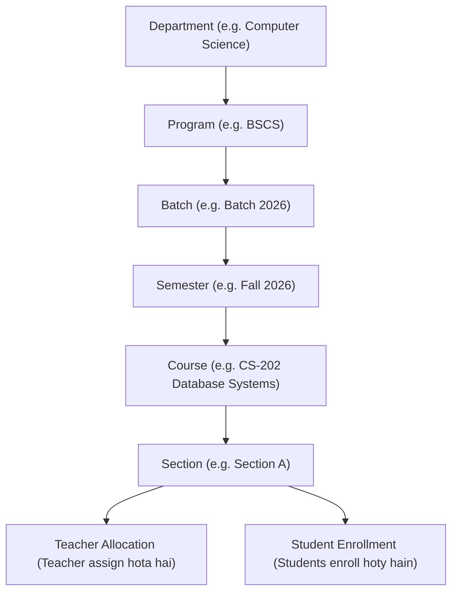

# Centralized College LMS (Learning Management System)
## Aasan aur Detailed Project Guide (Roman Urdu)

Yeh document aapke pure college project ka aasan alfaaz mein mukammal nichor (summary) hai. Isko parh kar aap kisi ko bhi — chahay professor ho, external examiner ho ya viva committee — apna pura project ba-asani samjha sakte hain.

---

## 1. Project Ka Ta'aruf (Project Overview)

### Yeh Project Kya Hai?
Yeh ek **Web-Based College / University Learning Management System (LMS)** hai. 
Aam taur par colleges aur universities mein attendance registers par lagti hai, assignments email ya WhatsApp par aati hain, aur students ko semester ke aakhir tak apne sahi marks ya attendance percentage ka pata nahi chalta.

Is project ka maqsad yeh hai ke university ki tamam academic activities ko ek hi jagah online aur centralized kar diya jaye:
1. **Admin** puri university ka structure (Departments, Degrees, Batches, Courses) set kare aur teachers ko sections assign kare.
2. **Teacher** lectures ke PDF/notes upload kare, assignments de, quizzes le, aur marks enter kare.
3. **Student** lectures parhe, material download kare, online quiz de, assignment submit kare, aur apna GPA aur attendance track kare.

---

## 2. Technologies (Yeh Kis Cheez Par Bana Hai?)

Aapke project mein industry ki modern aur tez tareen technologies use hui hain:

| Layer | Technology | Simple Roman Urdu Wajah (Why we used it) |
| :--- | :--- | :--- |
| **Frontend (UI)** | **React 19 + TypeScript + Vite** | Screen bina reload hue bohot fast chalti hai. TypeScript ki wajah se code mein bugs aur errors nahi aate. Vite project ko seconds mein start karta hai. |
| **Design / Styling** | **Tailwind CSS + Lucide Icons** | Modern dark theme, glassmorphism look aur clean icons jo presentation mein bohot attractive lagte hain. |
| **Backend (Server & APIs)** | **FastAPI (Python 3.11)** | Python ka sab se modern aur fastest web framework hai. Iska sab se bara faida yeh hai ke yeh automatically **Swagger Documentation** generate karta hai. |
| **Database ORM** | **SQLModel / SQLAlchemy** | Python code ko database ke sath connect karta hai taake manual complex SQL queries na likhni paren aur data secure rahe. |
| **Database** | **SQLite (Dev) / PostgreSQL (Prod)** | Local machine par testing ke liye SQLite file (`lms.db`) use hoti hai, aur production ke liye PostgreSQL ready hai. |
| **Security / Auth** | **JWT (JSON Web Tokens) + PBKDF2** | User ka password database mein encrypt (hash) ho kar save hota hai. Login karne par secure JWT token milta hai jo user ka role protect karta hai. |

---

## 3. System Ka Pura Flow (Academic Hierarchy)

Real university jis tarah chalti hai, aapka system bilkul usi flow par design kiya gaya hai:



Is hierarchy ka faida yeh hai ke:
- Koi bhi student kisi ghalat course ya section mein nahi ja sakta.
- Teacher sirf usi section ke students ko mark kar sakta hai jo admin ne use assign kiya hai.

---

## 4. Teeno Roles Ki Tafseel (Role-by-Role Panels)

Aapke system mein **Role-Based Access Control (RBAC)** hai. Har user sirf apna mutaliqa area dekh sakta hai:

### 👑 A. Administrator Panel (`admin@lms.com`)
Admin university ka "Superuser" hai.
- **Dashboard:** Pure system ki summary dekhta hai (Total Users, Courses, Departments, System Status).
- **User Management (`/admin/users`):** Naye students, teachers aur admins add karta hai, unka role change karta hai ya deactivate karta hai.
- **Batch Management (`/admin/batches`):** Har degree program ke naye cohorts/batches banata hai (e.g. Batch 2026).
- **Course Approvals (`/admin/courses`):** Dekhta hai ke kon sa course approved hai aur kon sa publish hona chahiye.
- **Academic Structure (`/admin/academic`):** Departments (CS, EE, BBA), Programs (BSCS, BSSE), aur Semesters manage karta hai.
- **Course Allocations (`/admin/allocations`):** **(Most Important Feature)** Yahan Admin select karta hai ke *"Section A ka instructor kon sa teacher hoga"*. Foran live save hota hai.
- **Policies (`/admin/policies`):** Minimum attendance threshold set karta hai (e.g. 75% se kam attendance par exam allow na ho) aur GPA scale set karta hai.

---

### 👨‍🏫 B. Faculty / Teacher Panel (`teacher@lms.com`)
Teacher apni classes ka academic content aur evaluation control karta hai.
- **Teacher Dashboard (`/teacher/dashboard`):** Teacher ko apne assigned courses, total enrolled students, aur ungraded assignments ki list nazar aati hai.
- **My Sections (`/teacher/sections`):** Assigned sections ki details aur students headcount check karta hai.
- **Materials Upload (`/teacher/materials`):** 
  - Lecture Slides, PDF notes, syllabus ya videos upload karta hai.
  - File direct server par save hoti hai aur foran students ke paas download ke liye available ho jati hai.
- **Lessons Builder (`/courses/:id`):** Course ke andar chapter-wise lessons likhta hai (Reading content, links, etc.).
- **Assignments (`/teacher/assignments`):** 
  - Naya assignment post karta hai with deadline aur total marks (e.g. 100).
  - Students ke submissions table mein dekh kar marks (e.g. 98/100) aur personalized feedback likh kar grade karta hai.
- **Quizzes Builder (`/teacher/quizzes`):** 
  - Online MCQs aur True/False questions add karta hai.
  - Time limit (e.g. 15 minutes) aur passing score set karta hai.
  - Students ke attempt scores live dekhta hai.
- **Attendance Marker (`/teacher/attendance`):** 
  - Date select karta hai aur tamam students ki attendance (Present / Absent) ek click par save karta hai.
- **Announcements (`/teacher/announcements`):** Important notices aur alerts post karta hai.

---

### 🎓 C. Student Portal (`student@lms.com`)
Student ka pura academic career is ek portal par hota hai.
- **Student Dashboard (`/dashboard`):** Enrolled courses, aane wali assignment deadlines, announcements, aur attendance percentage ek screen par.
- **My Courses (`/my-courses`):** Apne courses card format mein dekhta hai, sath mein teacher ka naam aur email show hoti hai.
- **Course Details (`/courses/:id`):** 
  - Har lesson khol kar parh sakta hai.
  - Teacher ki upload ki hui PDF / slides download kar sakta hai.
  - Discussion forum par sawal pooch sakta hai.
- **Assignments (`/my-assignments`):** Deadline se pehle apna solution text ya link submit karta hai. Graded hone par marks aur teacher ka feedback dekhta hai.
- **Online Quizzes (`/my-quizzes`):** 
  - Screen par countdown timer chalta hai.
  - Questions solve karta hai. Submit karne par system **foran auto-grade** kar ke score dikhata hai.
- **Gradebook (`/my-grades`):** Assignment aur quiz ke marks milakar GPA aur letter grade (A, B+, etc.) calculate ho kar display hota hai.
- **Attendance Tracker (`/my-attendance`):** Har course ki attendance percentage bar dekhta hai. Agar 75% se kam ho to warning show hoti hai.

---

## 5. Live University Scenario Example (Jo Humne Test Kiya)

Examiner ko samjhane ke liye yeh live example batayein:

1. **Step 1 (Admin):** Admin ne ek naya course banaya: `Database Systems (CS-202)` aur uski `Section A` banayi.
2. **Step 2 (Allocation):** Admin ne Allocations page par ja kar `Section A` ka teacher `Teacher User (teacher@lms.com)` ko chun liya.
3. **Step 3 (Teacher Verification):** Teacher ne login kiya to uske Dashboard par `CS-202 - Database Systems` foran show ho gaya!
4. **Step 4 (Upload & Assignment):** Teacher ne `Database_Lecture_01.pdf` upload ki aur ek assignment *"E-R Modeling & Normalization"* post kiya, sath hi student ki attendance "Present" mark ki.
5. **Step 5 (Student Submission):** Student ne login kiya, use teacher ki PDF mil gayi, usne assignment solve karke submit kiya.
6. **Step 6 (Teacher Grading):** Teacher ne submission open kiya aur **98/100** marks ke sath feedback diya: *"Outstanding normalization to 3NF!"*
7. **Step 7 (Final Report Card):** Student ne Gradebook kholi to 98% marks, teacher ka feedback aur 100% attendance verify ho gayi!

---

## 6. Examiner / Viva Defense Questions & Ready-Made Answers

### Q1: "Aapne Django ya PHP ki jagah FastAPI kyun use kiya?"
> **Jawab:** "Sir, Django kafi heavy aur monolithic framework hai jo purani server-rendered websites ke liye acha tha. Hamara frontend ek decoupled Single Page Application (React 19) hai. Is ke liye **FastAPI** asynchronous speed deta hai, Python ke data types ko auto-validate karta hai, aur automatically **OpenAPI (Swagger)** live documentation create kar deta hai."

### Q2: "Aapke project mein security kaise handle hui hai?"
> **Jawab:** "Sir, security do levels par hai:
> 1. Passwords database mein plain text mein nahi balki **PBKDF2-SHA256 cryptographic hashing** ke sath save hoty hain.
> 2. Login hone par client ko **OAuth2 JWT Token** milta hai. Har request ke header mein yeh token check hota hai. Agar koi student Admin ka URL access karne ki koshish kare to system use **403 Forbidden** return karta hai."

### Q3: "Jab Admin course assign karta hai to teacher ko kaise pata chalta hai?"
> **Jawab:** "Database mein `Section` table ke andar `teacher_id` ka foreign key column hai. Jab Admin allocation karta hai to section mein teacher ka ID save ho jata hai. Jab teacher dashboard kholta hai to query run hoti hai `WHERE Section.teacher_id == current_user.id`, jis se sirf wahi courses teacher ko load hoty hain jo uske naam par hain."

### Q4: "Kya ek waqt mein multiple students quiz de sakte hain?"
> **Jawab:** "Ji bilkul, backend stateless REST architecture par hai. Har student ka attempt database mein alag row (`QuizAttempt`) create karta hai with individual start time aur submit time. Ek waqt mein hazaron students parallel quiz de sakte hain."

### Q5: "Attendance policy kaise kaam karti hai?"
> **Jawab:** "System mein `AttendancePolicy` table hai jahan university standard (75% minimum) set hai. Jab student dashboard open karta hai to system uski total classes aur attended classes calculate kar ke percentage nikalta hai. Agar attendance 75% se kam ho to student ko red warning alert milta hai."

---

## 7. Project Ko Local Run Karne Ka Asaan Tareeqa

Agar aapko viva ya presentation ke din project dobara start karna ho to yeh steps hain:

### Terminal 1: Backend Start Karein
```powershell
cd d:\lms\backend
.\venv\Scripts\activate
python -m uvicorn main:app --host 127.0.0.1 --port 8000 --reload
```
👉 *API live:* `http://127.0.0.1:8000`  
👉 *Swagger Docs:* `http://127.0.0.1:8000/docs`

### Terminal 2: Frontend Start Karein
```powershell
cd d:\lms\frontend
npm run dev -- --host 127.0.0.1 --port 5173
```
👉 *Web App live:* `http://127.0.0.1:5173`

### ⚡ Naye Computer Par Auto Dummy Data Dalne Ka Tareeqa (Seed Script)
Agar aap kisi naye laptop ya computer par project clone karein to database mein poora dummy data (Departments, Courses, Teachers, Students, Submissions, Grades, Attendance, Quizzes) khud-bakhud add karne ke liye root folder mein sirf yeh command chalayein:
```powershell
python seed.py
```
*(Yeh script 2 seconds mein database create karke poora university structure setup kar deti hai).*

### 🔑 Ready-to-Use Login Accounts

| Role | Name / Department | Email | Password |
| :--- | :--- | :--- | :--- |
| **Admin** | System Administrator | `admin@lms.com` | `admin123` |
| **Teacher** | Dr. Sarah Jenkins (CS) | `teacher@lms.com` | `teacher123` |
| **Teacher** | Prof. Tariq Mahmood (CS) | `prof.tariq@lms.com` | `password123` |
| **Teacher** | Dr. Ayesha Malik (EE) | `dr.ayesha@lms.com` | `password123` |
| **Teacher** | Dr. Bilal Khan (CS) | `dr.bilal@lms.com` | `password123` |
| **Student** | John Doe (CS) | `student@lms.com` | `student123` |
| **Student** | Ali Ahmed (CS) | `ali.ahmed@lms.com` | `password123` |
| **Student** | Sara Khan (CS) | `sara.khan@lms.com` | `password123` |
| **Student** | Usman Raza (EE) | `usman.raza@lms.com` | `password123` |
| **Student** | Fatima Noor (EE) | `fatima.noor@lms.com` | `password123` |

---

## 8. Final Viva Tip

Viva ke waqt browser mein hamesha do tabs pehle se open rakhein:
1. **Frontend Tab:** [http://127.0.0.1:5173](http://127.0.0.1:5173) (Presentation aur features dikhane ke liye).
2. **Backend Swagger Tab:** [http://127.0.0.1:8000/docs](http://127.0.0.1:8000/docs) (Jab professor APIs ya backend schema ke baray mein pooche to foran yeh tab dikha dein — is se bohot zabardast professional impression parta hai).
